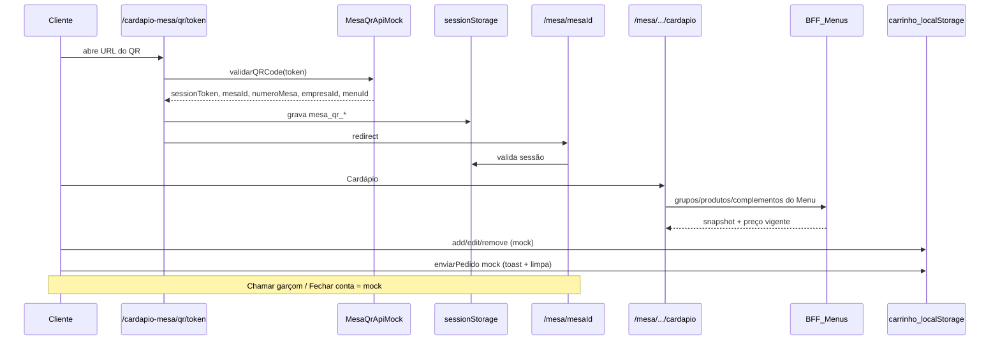

# Recriar: Cardápio de mesa (autoatendimento via QR)

Guia para reimplementar o fluxo de **cardápio presencial / autoatendimento na mesa**, reutilizando o catálogo atual (**Menus**, produtos, complementos) e **sem misturar** com o fluxo de **delivery público**.

---

## 0. Decisão de escopo (V1) — acordado

| Item | Decisão |
|------|---------|
| Branch de trabalho | `feat/cardapio-mesa-qrcode` (base: `developer`) |
| Escopo V1 | **FE + catálogo real via Menus (mesmo do pedido balcão)** + **pedido / garçom / conta / QR ainda em mock** |
| UI | Portar telas do commit `2968ac8a` para `/cardapio-mesa` |
| Catálogo | `novoPedidoProdutosApi` + `menuVendaGestorId` (`resolverMenuCatalogoNovoPedido` canal local/balcão) |
| Fora da V1 | BE público de sessão mesa, comanda real, KDS, geração de QR em produção |
| Prefixo de rotas | `/cardapio-mesa/...` (não usar `/cardapio/[slug]`; delivery vive em `apps/jiffy-cardapio`) |
| Isolamento | Produto separado do delivery (sem cotação, endereço, pagamento online) |

### O que a V1 entrega

1. Entrada simulada por QR (mock sempre válido) → grava sessão → home da mesa.
2. Home com **Cardápio**, **Chamar garçom**, **Fechar conta**.
3. Listagem de grupos/produtos/complementos a partir do **Menu** (snapshot + preço vigente), não do cadastro cru/`ativoLocal` antigo.
4. Carrinho em `localStorage` (mock): adicionar / editar / remover / “enviar pedido” (só limpa e toast).
5. Chamar garçom e fechar conta: UX real, resposta mock.

### O que a V1 NÃO entrega

- Validação JWT real do QR / abertura de mesa no BE.
- API pública sem login de ERP para o cliente na mesa.
- Persistência de comanda / envio ao KDS / compartilhador.
- Integração com checkout delivery.

> **Auth do catálogo na V1:** as rotas `/api/menus/*` do gestor são autenticadas. Na V1 o catálogo será lido via **BFF no App Router** (`app/api/...`) que usa a sessão/token da empresa no servidor (padrão já usado no ERP), ou em modo preview logado. Cliente 100% anônimo na mesa fica para a fase de BE público (pós-V1).

---

## 1. Fonte histórica (o que analisar)

| Item | Valor |
|------|--------|
| Branch histórica de referência | `feat/cardapio-mesa-qr` / commit `2968ac8a` |
| Criação original | `043f39fb` — *feat: criacao da estrutura do cardapio online* |
| Remoção / pivot para delivery | `7d2a40e1` — removeu `app/cardapio/qr/**` e `app/cardapio/mesa/**` |
| Branch antiga (nome original) | `feat/cardapio` (não existe mais como tip no remoto) |

Docs antigas ainda úteis (conceitos de BE/QR — fase pós-V1):

- `docs/PLANEJAMENTO_CARDAPIO_DIGITAL.md`
- `docs/BACKEND_CARDAPIO_DIGITAL.md`
- `docs/ESTRUTURA_TECNICA_CARDAPIO_DIGITAL.md`

> **Atenção:** `feat/cardapio-bkp` **não** é essa feature — já é modelo delivery por slug.

### Estado atual da base (`developer` / esta branch)

- **Não existe** `app/cardapio` no gestor; delivery público está em `apps/jiffy-cardapio`.
- **Não existem** `cardapioApiService` mesa-QR nem componentes `ChamarGarcom` / home mesa no código atual — serão recriados.
- **Existem** Menus (`/api/menus/...`, use cases, `precoVigenteSnapshot`) e Novo Pedido (regras de complementos / canal local) — base do catálogo da V1.

---

## 2. O que este fluxo é (e o que não é)

### É

- Cliente na **mesa física** escaneia QR → sessão vinculada à mesa.
- Navega cardápio **local** (Menu), monta itens com complementos.
- Ações de salão: **chamar garçom**, **fechar conta** (na V1: mock; depois: atendimento real).
- Canal: **local / presencial** via Menu (equivalente moderno de `ativoLocal`).

### Não é

- Delivery público (`apps/jiffy-cardapio`, layouts Básico/Vitrine, cotação, endereço, pagamento online).
- Carrinho delivery + `DeliveryPublicoCarrinhoScreen` + checkout atual.

---

## 3. Mapa de rotas

### Histórico (commit `2968ac8a`)

```
/cardapio/qr/[token]
/cardapio/mesa/[mesaId]
/cardapio/mesa/[mesaId]/cardapio
/cardapio/mesa/[mesaId]/carrinho
/cardapio/mesa/[mesaId]/chamar-garcom
/cardapio/mesa/[mesaId]/fechar-conta
...
```

### Alvo na V1 (sugerido)

```
/cardapio-mesa/instrucoes
/cardapio-mesa/qr/[token]                  → mock validar → sessão → redirect
/cardapio-mesa/mesa/[mesaId]               → home (3 CTAs)
/cardapio-mesa/mesa/[mesaId]/cardapio      → catálogo Menu
/cardapio-mesa/mesa/[mesaId]/carrinho      → carrinho mock
/cardapio-mesa/mesa/[mesaId]/chamar-garcom → mock
/cardapio-mesa/mesa/[mesaId]/fechar-conta  → mock
```

URL de teste (após implementar):

```text
http://localhost:3000/cardapio-mesa/qr/teste
```

---

## 4. Fluxo ponta a ponta (V1)



### Sessão (sessionStorage) — prefixo novo

| Chave | Uso |
|-------|-----|
| `mesa_qr_session_token` | Sessão pós-QR (mock na V1) |
| `mesa_qr_mesa_id` | Deve bater com `[mesaId]` da URL |
| `mesa_qr_numero_mesa` | Badge “Mesa X” |
| `mesa_qr_empresa_id` | Empresa |
| `mesa_qr_menu_id` | Menu usado no catálogo (V1) |

Sem sessão válida → `/cardapio-mesa/instrucoes`.

### Carrinho / pedidos / salão (V1 = mock)

- `localStorage`: `mesa_qr_carrinho_${sessionId}`.
- `enviarPedido`, `chamarGarcom`, `fecharConta`: mock (sucesso + toast; pedido limpa carrinho).
- Contrato de serviço espelhando o antigo `ICardapioApiService`, com implementação mock + stubs para fase BE.

### Catálogo (V1 = mesmo do pedido balcão)

- Fonte: `fetchGruposCatalogoVenda` / `fetchProdutosCatalogoPagina` / `fetchProdutoCatalogoPorId` / hidratação de complementos em `novoPedidoProdutosApi.ts`.
- `menuId` = `resolverMenuCatalogoNovoPedido(canalLocal, null, menuVendaGestorId)` — **mesmo menu do Novo Pedido balcão**.
- Auth V1: preview com empresa logada no gestor (token ERP). Cliente anônimo = pós-V1.
- **Não** usar o padrão antigo `/api/grupos-produtos` + JWT no client da página mesa.

---

## 5. Arquivos históricos de referência (`2968ac8a`)

Úteis como referência de UX (não copiar catálogo autenticado antigo):

- `app/cardapio/qr/[token]/page.tsx` — validação + sessão + redirect
- `app/cardapio/mesa/[mesaId]/page.tsx` + `CardapioHomeScreen` — 3 CTAs
- Modais `ChamarGarcomModal` / `FecharContaModal`
- `CarrinhoCompleto` / fluxo de itens
- `cardapioApiService.ts` — contrato mock/real

```bash
git show 2968ac8a:app/cardapio/qr/[token]/page.tsx
git ls-tree -r --name-only 2968ac8a -- app/cardapio src/presentation/components/features/cardapio-digital src/infrastructure/api/cardapio
```

---

## 6. Limitações do protótipo antigo (não repetir)

1. Catálogo com JWT admin no browser.
2. Sem Menus (só `ativoLocal` no cadastro).
3. Pedido/KDS só mock.
4. QR sempre válido (ok na V1; real depois).
5. Branding hardcoded.

---

## 7. Fases

### Fase V1 (esta branch) — FE + Menus + mocks

1. Rotas `/cardapio-mesa/...` + layout isolado (sem TopNav ERP).
2. Mock `validarQRCode` + sessão `mesa_qr_*`.
3. Home com 3 CTAs + número da mesa.
4. BFF/leitura de **Menu** (grupos, produtos, preço, complementos).
5. UI de catálogo + modal de configuração (regras alinhadas ao Novo Pedido / menu).
6. Carrinho mock + enviar pedido mock.
7. Chamar garçom / fechar conta mock.
8. Commit deste doc na branch.

### Fase pós-V1 — BE público + comanda real

1. `POST /api/cardapio-mesa/qr/:token/validar` (JWT mesa).
2. `GET .../sessao/:id/cardapio` público (menu local sem login ERP).
3. Carrinho/comanda server-side + `enviarPedido` → cozinha/KDS.
4. Eventos reais de garçom / fechar conta.
5. Geração/impressão de QR por mesa.

### Checklist V1

- [ ] QR mock → sessão → home
- [ ] Sessão amarra `[mesaId]`
- [ ] Home: Cardápio / Chamar garçom / Fechar conta
- [ ] Catálogo do **Menu** (grupos + produtos + preço vigente)
- [ ] Complementos conforme menu
- [ ] Carrinho mock (qty / editar / remover / enviar)
- [ ] Garçom e fechar conta mock
- [ ] Isolado do delivery
- [ ] Doc commitado nesta branch

### Reaproveitar da base atual

| Área | Uso na V1 |
|------|-----------|
| `IMenuRepository` + use cases `menus/*` | Catálogo |
| Policies `menu/precoVigenteSnapshot` | Preço |
| Lógica de complementos do Novo Pedido | Modal |
| UX do commit `2968ac8a` | Home, QR, garçom, conta, carrinho |
| **Não** reaproveitar | Checkout delivery, cotação, layouts Vitrine como home mesa |

---

## 8. Contrato BE (pós-V1 — referência)

1. `POST /api/cardapio-mesa/qr/:token/validar` → sessão + mesa + menuId  
2. `GET /api/cardapio-mesa/sessao/:sessionId/cardapio` → menu local  
3. Carrinho/comanda CRUD  
4. `POST .../pedidos`  
5. `POST .../chamar-garcom`  
6. `POST .../fechar-conta`  

Detalhes: `docs/BACKEND_CARDAPIO_DIGITAL.md`.

---

## 9. Recuperar código antigo

- `git show 2968ac8a:caminho` ou worktree temporário no commit.
- Evitar checkout da tip antiga em cima do working tree com `apps/` do monorepo.

---

## 10. Resumo

**V1 (agora):** na `feat/cardapio-mesa-qrcode`, recriar o UX mesa/QR com **catálogo real de Menus** e **pedido/salão/QR em mock**, em rotas `/cardapio-mesa`, separado do delivery.  
**Depois:** BE público de sessão + comanda/KDS reais.
